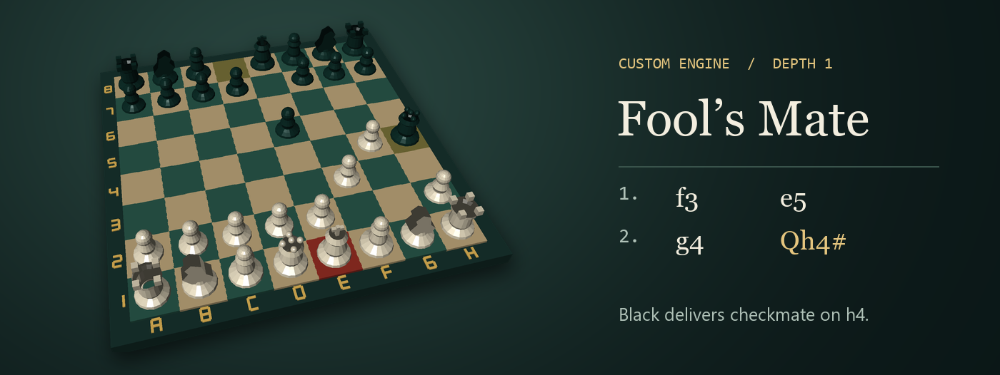

# Chess3D · Tournament Room

Chess3D is a browser chess application built around a custom JavaScript engine and an interactive WebGL board. Play either side to explore a position, or sit across from the engine in a timed game where you have to press your own clock.

## What I built

**I designed and wrote CustomChessEngine’s algorithms and classical evaluation entirely myself.** I chose how the engine searches the game tree and how it scores a position, from the value of a piece on a particular square to the effect of an exposed king. [Move search](CustomChessEngine/search.js) · [Position evaluation](CustomChessEngine/evaluate.js)

I also designed the **3D renderer** and used AI to polish it. Its piece geometry, camera, and square selection are implemented in the [WebGL scene](js/rendering/solid-board.js).

I used AI to build the rest of the application infrastructure, including the browser interface, engine adapters, coaching and training tools, multiplayer relay, and launch scripts. The default opponent is my custom engine. Stockfish is a separate third-party engine available for comparison and move grading.



## Run it

Download or clone this repository and open its folder. The browser engine and opening lessons run directly from the checked-in JavaScript and JSON.

| Platform | Start the app |
| --- | --- |
| Windows | Double-click **Play.cmd**. It opens the app and starts the available local services. For just the board, custom engine, and lessons, run `.\Play.cmd -WebOnly` in PowerShell. |
| macOS or Linux with Python 3 | Run `python3 -m http.server 8787 --bind 127.0.0.1` in the project folder, then open the address below. |
| macOS or Linux with PowerShell 7 | For the full launcher, run `pwsh -File ./tools/start-tournament-room.ps1`. It looks for a native `stockfish` on your PATH. You can also pass `-EnginePath /path/to/stockfish`. |

Open [Tournament Room on localhost](http://127.0.0.1:8787/). Keep the terminal open while playing and press **Ctrl+C** there to stop. Serving the page over HTTP lets the browser load the engine worker and the opening repertoire. WebGL enables the 3D view. A browser without WebGL gets a playable keyboard-accessible 2D board.

## Try a one-minute engine demo

1. Choose **Analysis board**, leave **CustomChessEngine** selected, and set **Search depth** to **1**.
2. Play **1. f3 e5 2. g4**. Click the source and destination squares for each move. Black now has mate in one.
3. Look at **Position analysis**. The engine suggests **Qh4#** (`d8h4`). Play that move to see checkmate on the board and in the scoresheet. **Take back** lets you explore the position again.

Before Black moves, the classical evaluator scores the board **−1.67 pawns** from White's perspective. Searching just one ply reveals that Black can already deliver checkmate. You can see the difference between evaluating a position and exploring its legal moves on the same screen. The same tactic is covered by the [engine regression tests](CustomChessEngine/search.test.mjs).

## Inside the implementation

| Component | How it works | Read the code |
| --- | --- | --- |
| Board representation | BigInt bitboards track piece locations. Search makes and unmakes moves on one board as it explores alternatives. | [Bitboard implementation](CustomChessEngine/board.js) |
| Move search | Iterative deepening explores progressively longer lines. Alpha–beta pruning skips branches that cannot improve the result, a transposition table reuses previous work, and quiescence search examines tactical continuations at the depth limit. | [Search](CustomChessEngine/search.js) · [Hashing and tables](CustomChessEngine/tables.js) |
| Static evaluation | Material and piece-square scores are combined with pawn structure, king safety, mobility, and development. The evaluator blends opening and endgame terms as material comes off the board. | [Classical evaluator](CustomChessEngine/evaluate.js) |
| 3D rendering and input | Piece meshes are built from revolved profiles, extrusions, and boxes. The renderer lights them with shaders and projects pointer input back onto the board to select squares and pieces. | [WebGL scene](js/rendering/solid-board.js) · [Board input](js/rendering/renderer.js) |
| Engine integration | The app sends a FEN position to a module worker. The worker builds the engine's board, runs the search, and returns a move, score, node count, and elapsed time. This keeps the board interactive during a search. | [Worker adapter](js/engines/custom-engine-worker.js) · [Chess rules and notation](js/domain/chess.js) |

## Play and training modes

| Mode | What to try | Runs with |
| --- | --- | --- |
| Analysis board | Play both sides, change search depth, take back a move, and compare suggested continuations. | Custom engine in the browser or local Stockfish |
| Tournament simulation | Choose a color and time control. Touch a movable piece, play it, then press your clock. The engine presses its own clock after replying. | Custom engine, local Stockfish, or a second device |
| Opening Prep | Step through a line, then practice it from memory. Twelve chapters cover the Italian, Ruy Lopez, Queen's Gambit, Sicilian, French, and Caro-Kann. Progress is saved in the browser. | Bundled [opening repertoire](data/openings/openings.json) |
| AI coach | Review material, pawn structure, and king safety. Connect Stockfish for move grades, alternative lines, and win/draw/loss estimates. An optional trained checkpoint adds concept and policy predictions. | Static features in the browser, Stockfish for grading, optional Python inference |

Click or drag a piece on the 3D board. Use **W/A/S/D** to pan, **Space/Shift** to zoom, **I/K** to adjust tilt, and **J/L** to turn. **Flip board** changes perspective. **Save game** stores the position and move history in this browser and downloads a PGN. **Copy FEN** copies the current position.

## Stockfish, network games, and the optional coach

- **Stockfish.** The launcher starts a loopback UCI bridge on port `8765`. The bundled executable targets Windows x86-64 CPUs with AVX2 and is stored using Git LFS. If the launcher reports an LFS pointer, run `git lfs pull` from a clone with Git LFS installed, or supply a compatible executable with `-EnginePath`. Stockfish's source, credits, and GPLv3 license are in [lib/stockfish](lib/stockfish).
- **Two-device games.** Start the full launcher and connect both devices to the same local network. Open the printed network address on the second device. On both, choose **Tournament simulation** and **Another device**. Choose **Create match** on the host and **Join match** on the guest, then enter the host's six-character code. The web server uses port `8787` and the room relay uses `8766`.
- **Neural coach.** The launcher looks for `ai/artifacts/chess-coach-grounding.onnx` first, then the `.pt` checkpoint. The model service runs on loopback port `8770`. Stockfish grading works independently of a trained checkpoint. Setup, PGN labeling, JSONL export, and model training are documented in the [AI guide](ai/README.md).
- **Launcher options.** `-NoBrowser` prints the address without opening a tab. `-WebOnly` binds the board server to loopback and skips service startup. `-NoGrounding` skips neural inference. To use a different port, pass `-WebPort`, `-BridgePort`, `-RoomPort`, or `-GroundingPort`. For example, `.\Play.cmd -WebOnly -WebPort 9000` serves the board at [localhost:9000](http://127.0.0.1:9000/).

## Run the tests

From the repository root, use Node.js 24 or newer for the complete JavaScript suite, including the Zstandard dataset tests.

```sh
node --test
```

To run just the engine's tactical tests, use `node --test CustomChessEngine/search.test.mjs`. The broader suite also checks legal opening lines, coach scoring conventions, and the dataset pipeline.
